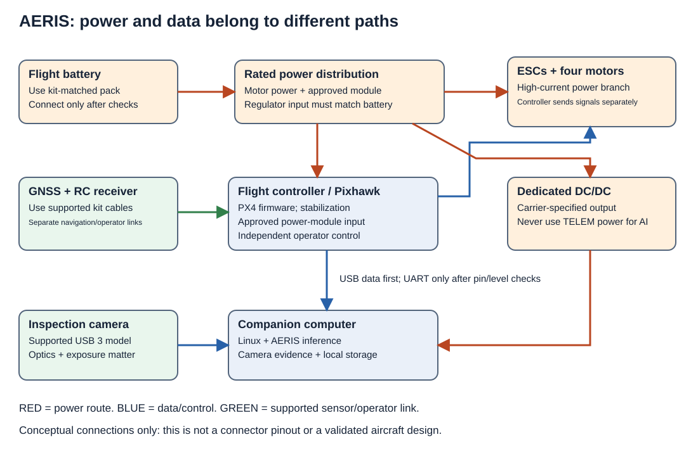
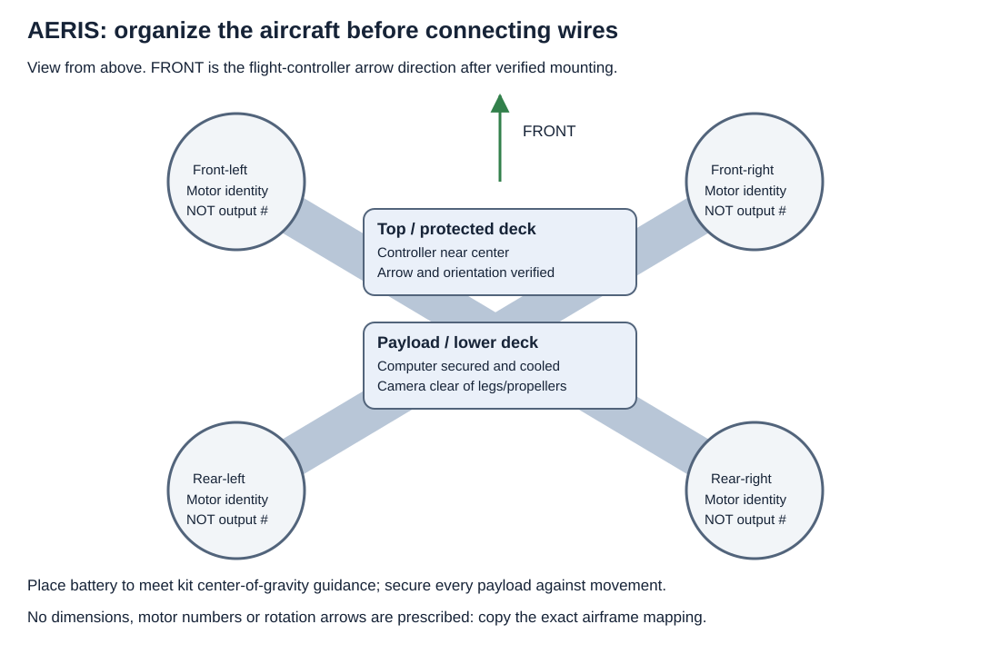
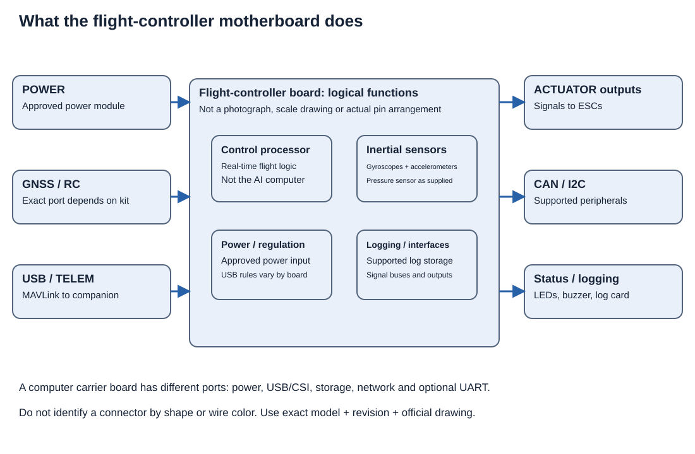
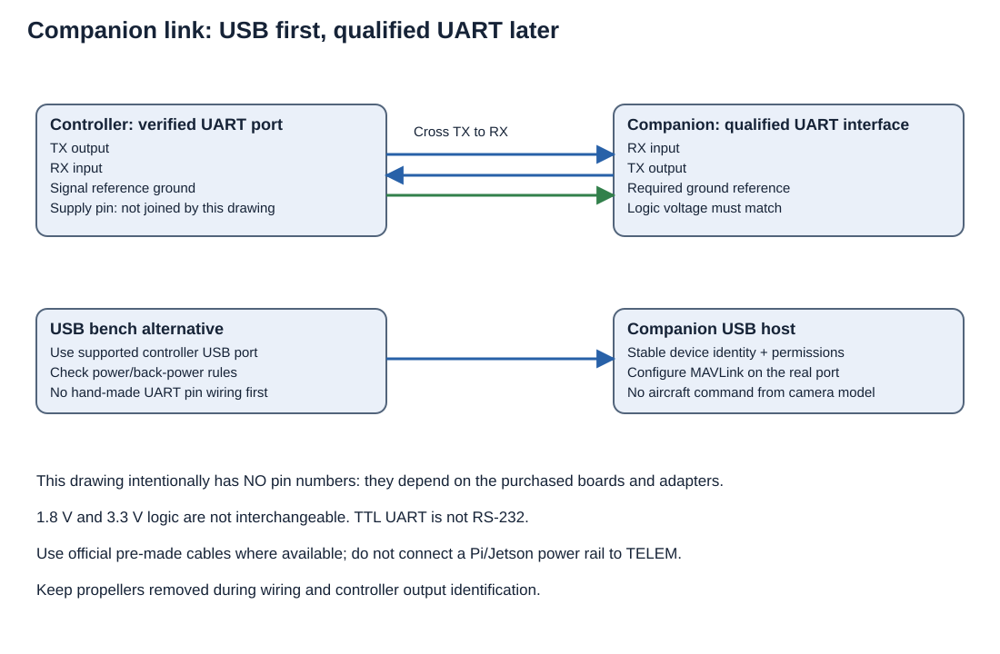

# AERIS student build manual: from boxes of parts to an inspection prototype

**Start here if you have never built a drone.** You said you have no hardware yet. This manual uses a supported quadcopter kit, not a homemade flight-controller PCB, as the first aircraft. A separate [custom airframe/controller development guide](custom_airframe_and_controller.md) explains what making those parts yourself involves.

The reference family is a **Holybro X500 V2-class development kit offered with a Pixhawk 6C-class controller**, if an actually available kit configuration has compatible documentation and enough payload allowance. This is a procurement candidate, not a purchased/tested configuration. Check the exact current kit contents, airframe instructions and controller revision before ordering. Do not add a heavy AI computer to a kit merely because it physically fits.

First milestone: build and configure the basic kit, take good images under operator supervision, and run detection offline. Add onboard AI only after measuring its mass, power and cooling requirements. For a school project, use a teacher/qualified builder for electrical work, battery charging, motor commissioning and flight instruction. Propellers stay removed for all wiring and motor-output identification below.

## 1. Understand the machine in plain language

| Part | What it does | What it does not do |
|---|---|---|
| Frame | Holds the aircraft together | Does not decide how to fly |
| Motor + propeller | Creates thrust | Cannot be powered directly from a controller signal pin |
| ESC | Switches battery power to a motor according to commands | Is not the flight-controller computer |
| Flight controller | Reads sensors and commands the ESCs to stabilize/fly | Does not normally run the railway image model |
| Power module/distribution | Routes rated power; may measure voltage/current | Does not automatically provide every device's required voltage |
| GNSS/compass | Supports navigation/heading estimation | Does not make every place safe or provide reliable indoor navigation |
| Radio receiver + transmitter | Gives the operator a supported control path | Is separate from the AI/cloud link |
| Companion computer | Runs Linux, records images and runs AERIS | Must not replace the controller's stabilization loops |
| Camera + lens | Collects inspection evidence | Cannot see a detail that is too small/blurred in the image |
| Ground station | Configures and monitors the controller | Is not the controller's real-time motor loop |



Read red lines as **power routes**, blue as **data/control routes**, green as **supported sensor/operator connections**. These are conceptual diagrams, not pin-number drawings. Matching two connectors by appearance is not an electrical compatibility check.

## 2. Choose one build path, not a mixture of unrelated shopping lists

### Path A — your first aircraft

Purchase a supported airframe/propulsion/controller development kit with complete assembly instructions and documented battery/charger requirements. Add a compatible radio control system and the supported ground station. Keep the inspection payload small at first, or collect imagery using the kit's supported payload mounting approach and process it on the ground.

### Minimum packing-list categories for a conventional quad kit

| Category | Usual count to account for | Check against the exact kit |
|---|---|---|
| Airframe/landing structure | One complete assembly | Correct plates/arms/landing parts and all fasteners |
| Motors | Four matched units | Kit-prescribed motor and mounting screws |
| ESC channels | Four channels, discrete or supported integrated assembly | Matched motor/battery ratings and signal protocol |
| Propellers | Full manufacturer-specified rotation/type set plus appropriate spares | Correct size, attachment and rotation pattern; remain off during bench work |
| Controller/power system | One supported controller and its approved supply/measurement arrangement | Revision-specific cables and manuals |
| Navigation/operator link | Supported GNSS and independent RC equipment as required | Kit inclusions vary; do not assume both radios are supplied |
| Battery/charger | Supported pack and matching charger | Usually separately selected; confirm actual bundle |
| Data/logging/mounts | Supported log storage, setup cable and all required mounts | Review what the exact SKU excludes |

The count table organizes purchasing; it does not override the manufacturer's matched component specification.

### Path B — add a recording/AI payload

After the base vehicle is commissioned, measure a candidate companion/camera system on a bench. A Pi 5 can be a recording/low-rate inference candidate; a Jetson Orin Nano carrier/module can be a GPU inference candidate. Both need compatible OS, regulated power, cooling, storage and reliable mounting. The kit's payload rating must include all of those items. If it cannot carry them with the required performance margin, choose a different rated platform rather than improvising a motor/battery upgrade.

### Path C — custom kit or custom controller

Do this only after Path A works and you can compare against a known-good system. The advanced guide covers mechanical design, electrical design, firmware and validation. There are no flight-qualified custom Gerber files or fabricated boards in this repository.

## 3. Organize your project before spending money

Make these folders outside the source tree for your physical build records:

```text
my-aircraft-build/
  01-manuals-and-datasheets/
  02-parts-and-serial-numbers/
  03-wiring-and-photos/
  04-power-and-mass-measurements/
  05-firmware-and-parameters/
  06-bench-results/
  07-flight-and-camera-logs/
```

Download exact model/revision manuals and save their source URLs and dates. Copy the repository's [BOM worksheet](../../examples/hardware/prototype_bom.csv), [wire schedule](../../examples/hardware/wire_schedule.csv), [assembly checklist](../../examples/hardware/assembly_checklist.csv), [motor map](../../examples/hardware/motor_map.csv), and [power worksheet](../../examples/hardware/power_and_mass.csv). Fill in actual parts and measurements. Blank cells are outstanding work, not approval.

Before ordering, verify the complete kit configuration with the vendor. These are the questions to answer:

- Does this SKU include the frame, four matched motors, four ESCs or a matched integrated board, propellers, landing gear, controller, power module, GNSS and mounting hardware?
- Which battery cell count/voltage, connector, charger and battery mounting are supported?
- What additional receiver/transmitter and telemetry equipment is needed?
- Which exact controller board, revision, cables, firmware target and airframe configuration apply?
- What is the **documented** payload envelope, and which flight-time claims include which payload and battery?
- What is the return/support process if a camera or driver does not work with your computer?

Do not infer kit contents from an old video. A product family can have several incompatible bundles.

## 4. Tools and supplies

| Item | Purpose / beginner rule |
|---|---|
| Manufacturer-specified hex drivers/screwdrivers | Use the right size to avoid damaged fasteners |
| Multimeter with suitable rated probes | Verify polarity/voltage and continuity with an instructor; never measure current by placing current-mode probes across a battery |
| Manufacturer-specified fasteners/mounts | Use supplied sizes; screws that are too long can contact motor windings |
| Strain relief, suitable cable ties and protective sleeving | Prevent wires reaching propellers, sharp carbon edges or hot parts |
| Labels and notebook | Give each harness and motor a stable ID |
| Supported battery charger and charge area | Match chemistry and cell count; supervise charging using the battery/charger instructions |
| Eye protection and appropriate work area | Especially for cutting, soldering and motor commissioning |
| Soldering tools only if the kit requires them | Teacher/qualified builder handles soldering; avoid hand-made high-current harnesses for a first build |
| Bench supply/current limiting when suitable | For qualified low-voltage electronics bring-up; not a universal substitute for the kit's battery/power instructions |

Buy approved pre-made cables where possible. A connector shell can hide the wrong pin order. Do not rely on wire color alone. Follow the kit's specified thread-locking/torque instructions: a product suitable for metal threads may damage plastic or be unsuitable near electrical parts.

## 5. Mechanical assembly: build a frame, not a pile of modules



The drawing labels **physical positions**, not PX4 motor numbers. It is not dimensioned or a mounting-hole template.

1. Lay out and identify the kit parts against its packing list. Photograph them before assembly.
2. Read the entire kit assembly manual, including wiring routes, before tightening parts into inaccessible spaces.
3. Assemble the arms/plates/landing gear in the documented order. Do not drill structural parts or substitute screw lengths casually.
4. Mount each matched motor/ESC using the kit instructions. Check that wires are not pinched and rotating parts are unobstructed. **Do not fit propellers.**
5. Install the power module/distribution using its insulation and mounting instructions. Carbon-fiber plates can conduct electricity; exposed conductors must not rest on them.
6. Mount the flight controller using the supplied isolation/orientation method. Record the board arrow direction and any required firmware orientation setting. Do not stack it directly on a noisy power converter just because the mounting holes line up.
7. Mount the GNSS/compass/receiver as instructed, with appropriate separation from high-current wiring and obstructions.
8. Position the battery mounting provision without connecting power. Verify the battery cannot slide and cables cannot reach propeller disks.
9. Reserve a clear camera view and the measured companion's mounting space. The companion needs airflow and must not distort the controller's isolation mount.
10. Check the completed mass and balance against the kit requirements. Photograph the top, bottom, each arm and every connector before closing plates.

If a part needs bending, trimming, forcing or an undocumented adapter to fit, stop and resolve the mismatch from the actual manuals rather than forcing it into place.

## 6. Motherboard details: which board is which?

There is **not one universal UAV motherboard**. Your build has several boards with different jobs.



This is a functional drawing. Its connector positions do not match any specific Pixhawk board.

### Flight-controller board

- Main microcontroller executes the real-time flight firmware.
- Inertial sensors measure rotation/acceleration; supplied pressure sensing supports estimation.
- Power circuitry supplies regulated internal rails and monitors health.
- Actuator outputs send command signals to ESCs; motor current does not flow through those signal pins.
- GNSS/RC/telemetry/peripheral interfaces connect supported devices.
- Logging storage, status indications and debug/boot interfaces depend on the board.

Use the exact board's **pinout/connector diagram** and PX4 hardware documentation. Some components are internal and must not be probed or modified by a beginner.

### Companion board/carrier

A Pi or Jetson carrier exposes computer power, storage, USB, network and supported camera/serial interfaces. It runs Linux and the image pipeline. A Jetson compute module is not the same as its carrier: carrier input voltage and connector layout come from the carrier manual.

### ESC/power boards

An ESC contains power switches/control electronics for its motor. A distribution board routes battery power. A power module can also measure voltage/current and provide an approved controller supply. A four-in-one board can combine functions, but this does not make its pinout universal.

## 7. Make the wire schedule before connecting the wires

For each cable write source device, exact source connector/pin, destination connector/pin, signal name, electrical level/rating, cable part number and official drawing reference. Have a qualified builder compare the completed schedule to both device manuals. The [wire schedule](../../examples/hardware/wire_schedule.csv) deliberately leaves model-specific pins blank.

### Connection order

Work unpowered, propellers removed, in the kit's documented order:

1. Motor/ESC power connections and motor phases exactly as supplied/instructed.
2. Approved power-module/distribution input and flight-controller supply connector.
3. ESC command/ground connections to the documented controller actuator outputs.
4. GNSS/compass and receiver using the exact supported cables/ports.
5. Telemetry hardware if required by the chosen configuration.
6. Controller USB to the setup computer for the first firmware/configuration stage, following USB/power instructions.
7. Only after the aircraft baseline is commissioned: separately qualified companion power and camera link.

Do not power a Jetson or Pi from TELEM. Do not join multiple supply outputs without an approved power arrangement. Never attach a battery directly to GPIO, UART or a USB camera.

### Power diagram

```text
KIT-MATCHED BATTERY
    |
    +-- rated distribution ------------------> ESCs --> motors
    |
    +-- approved controller power module ----> flight-controller power input
    |
    +-- qualified dedicated regulator --------> companion's specified power input
                                                   |
                                                   +--> supported camera/storage power
```

Only use the final branch after verifying regulator input range, output, peak/steady load, cooling, polarity and grounding with the actual hardware. Camera/storage power may require a separately rated supply arrangement; a USB port is not an unlimited power source.

## 8. Companion connection: USB first



For first bench integration, use a supported USB data connection between controller and companion. Check the devices' allowed powering/back-powering arrangement. Confirm device identity and permissions; do not assume the same `/dev/ttyACM0` name after every reboot.

Only later design a UART harness:

```text
Controller TX       -> compatible companion RX
Controller RX       <- compatible companion TX
Required reference  <-> required reference, according to the interface documentation
```

TX means transmit; RX means receive. Match logic voltages: 1.8 V, 3.3 V and RS-232 are not interchangeable. Add an approved level/interface adapter if required. Supply pins are **not** part of this generic signal diagram. Flow-control wiring is included only if both ends support/configure it.

Exact pin numbers cannot be chosen until the purchased boards/carriers and revisions are known. The correct beginner action is to copy the official pin drawing into your wire schedule, not to guess from this illustration. No off-the-shelf connector shape guarantees those signals are on the same pins.

## 9. First electrical checks, with the instructor

Before connecting the flight battery:

- Verify all connectors against the wire schedule and physical orientation marks.
- Confirm the battery/charger/ESC/power-module voltage compatibility.
- Inspect for loose strands, reversed connectors, exposed pads, trapped wires and screws contacting electronics.
- Check the manufacturer's permitted USB and power-module combinations.
- Use continuity/polarity measurements only as taught for the circuit. Capacitors and semiconductor paths can make a continuity beep ambiguous; do not interpret it as a complete electrical test.
- Test a new companion regulator separately with qualified current limiting/load testing before attaching the computer.
- Remove propellers, loose tools and conductive debris from the test area.

Power up using the kit's documented sequence. If unexpected heat, smell, smoke or unstable voltage appears, disconnect using the appropriate safe method and diagnose unpowered. Do not repeatedly reconnect to see whether the fault goes away.

Record the observed input/rail voltages, idle current where properly measured, temperatures and status indications. A flashing LED means something board-specific; consult its manual rather than guessing that it is normal.

## 10. Install firmware and configure the base aircraft

Use the supported ground-station version and the exact board firmware target.

1. Record the controller model/revision and firmware release.
2. Install the supported firmware using the official board workflow.
3. Choose the correct airframe geometry/configuration, not just something called “quadcopter.”
4. Set controller orientation to match physical mounting, then perform required sensor calibration.
5. Configure receiver/protocol and verify channel direction, neutral values and operating modes in the setup interface.
6. Configure battery voltage/current measurement using the supported power module's calibration procedure.
7. Configure the applicable geofence, battery, RC/link-loss and mission contingencies.
8. Follow the supported actuator setup/output identification described next.
9. Export the reviewed parameters, firmware identity and configuration screenshots.

Do not disable arming checks to get past an unexplained error. Some calibration requires an appropriate environment; indoor GNSS failure is not a reason to fake position health. The flight controller's supplied manual is authoritative for its procedures.

## 11. “Mixing”: how four motors work together

The relevant ideas are **airframe geometry**, **actuator mapping**, **ESC protocol** and **control allocation/mixing**.

| Term | Meaning |
|---|---|
| Physical location | Front-left/front-right/rear-left/rear-right relative to the configured body frame |
| Motor identity | The motor identifier shown by the selected firmware/airframe setup |
| Output assignment | Which real output connector sends that motor's command |
| ESC protocol | The supported command format configured for the ESC/output hardware |
| Rotation direction | Which way the motor/propeller combination must turn in the selected airframe scheme |
| Mixer/control allocator | Firmware logic that distributes desired forces/torques across actuators |

For a conventional quad, changing thrust differences produces roll/pitch, and the appropriate rotation pattern supports yaw torque. The exact mapping/signs depend on the selected configuration. **Do not program a homemade Python motor mixer for this beginner build.** PX4 provides the aircraft control allocation; AERIS handles inspection evidence, not per-motor stabilization.

### Motor mapping procedure — propellers removed

1. Open the actuator/motor setup for the exact airframe and firmware release.
2. Save its diagram/screenshot in your build records.
3. In the kit's prescribed bench configuration, use the ground station's supported output-identification function with the qualified builder controlling the test area.
4. Observe which physical motor corresponds to each displayed motor identity/output. Record it in [motor_map.csv](../../examples/hardware/motor_map.csv).
5. Verify the prescribed rotation using the kit/ESC/firmware method. If it is wrong, follow that manufacturer's correction process. Different ESC protocols support different methods; do not assume one generic “reverse” instruction applies.
6. Check that the configured airframe, assignments, wiring and observed movement agree for every motor.
7. Stop and resolve any mismatch before continuing. Save the resulting mapping and configuration.

There is intentionally no universal “motor 1 = front-left” table in this manual. Copying numbering from a different firmware or frame can create a dangerous configuration.

Propellers stay off until all bench work is finished and the operator is ready for the aircraft manufacturer's supervised flight commissioning procedure. Propeller type/orientation, fastener torque and mounting method must match the exact motor/airframe rotation scheme. Never attach them just to make an indoor test look like a drone.

## 12. Configure and test the camera payload on the bench

Choose a camera/lens using the [hardware guide](../uav_hardware_and_connections.md), not the word “4K” alone. Verify driver support for the actual OS/architecture before buying. A supported USB camera is usually easier for a beginner than a CSI module requiring a custom driver.

1. Connect the camera to a supported computer using its documented power/data arrangement.
2. Install its official driver/SDK or use the supported OS camera path.
3. Capture original-resolution pictures of a measured mock inspection target.
4. Set and record exposure/focus/gain. Check image edges, lighting variation, blur, timestamp behavior and dropped frames.
5. Test the lens and camera geometry against the smallest target feature. Enlarging a blurred image does not add detail.
6. Measure sustained recording, storage and processing rates.
7. Repeat on the intended companion, using its own supported OS and drivers.

On Linux a V4L2 camera may be inspectable using `v4l2-ctl`; vendor-SDK and CSI cameras can require different tools. Do not assume `/dev/video0` identifies the same camera every time.

## 13. Bring AERIS into the build

Use the exact commands in the [implementation guide](../implementation_guide.md) for environment setup and training. The intended flow is:

```text
Annotate UAV images on workstation
    -> validate dataset -> train -> best.pt + class map + threshold + provenance
    -> copy the validated artifact set to companion
    -> camera captures local files
    -> AERIS prediction -> saved evidence -> human review / offline mission replay
```

For a first companion inference check after compatible dependencies are installed:

```sh
python -m aeris.vision predict --weights /absolute/path/to/best.pt --source /absolute/path/to/captures --conf 0.25 --imgsz 1024 --device cpu --output outputs/first-companion-test
```

Replace threshold/input size with your validation-selected values. `--device 0` is for a separately validated CUDA stack, not a shortcut to make GPU hardware work. The desktop dependency installation is not an automatic Jetson/Pi installation recipe.

The current code processes recorded images. It does **not** automatically start a live camera, associate images with real telemetry, fly the route, avoid obstacles or land on a dock. Those integration components are described in the implementation/hardware guides and must be developed and tested separately.

## 14. Ground tests before flight

Complete and photograph these independently:

- Mechanical inspection and complete mass/balance record.
- Power/voltage/thermal checks and camera/compute sustained-load test.
- Controller orientation/sensor/receiver/actuator configuration.
- Verified physical motor/output/rotation map, with propellers removed.
- Telemetry recording and manufacturer-supported contingency checks.
- Camera resolution/quality check and offline model error review.
- Simulator route, return and interruption behavior as documented in the implementation guide.

If the companion loses power, the base vehicle's intended contingency must remain defined. If camera/inference fails, coverage stays unresolved. Do not interpret empty predictions as a verified healthy railway.

## 15. First flight is a different activity from assembly

Use a qualified operator, appropriate site/permissions and the kit's documented commissioning procedure. Start with the aircraft baseline before adding an unverified payload or autonomous inspection requests. Keep the independent operator control path and follow the operating limits. Do not test over people, trains or an active railway as a school integration experiment.

After each approved test, inspect fasteners/wiring, battery condition, vibration, temperatures, aircraft logs and image quality. Add the payload only after its mass/power/mounting have been accepted for the platform. Keep the inspection software passive at first: record images, evaluate on the ground, and compare against independent labels.

## 16. Troubleshooting for beginners

| Symptom | What to check next |
|---|---|
| Parts do not fit | Exact kit/revision and assembly step; do not force or drill without reviewed design changes |
| Controller has no power | Approved supply path, voltage/polarity and connector drawing; do not try random pins |
| Computer reboots when camera starts | Regulator/USB startup current, voltage drop, cable and thermal load |
| No controller USB device | Data-capable cable, supported port/power mode and OS permissions |
| No GNSS indoors | Expected reception limits; use the specified test environment, not fake health flags |
| Wrong motor moves in setup | Output assignments and exact airframe mapping; props remain removed |
| Camera not visible | Driver/SDK/ARM64 support, cable bandwidth, power and OS image |
| Good workstation inference but poor onboard behavior | Same model hash/preprocessing, supported runtime, thermal throttling and dropped frames |
| High detector score at wrong asset | Missing pose/time/asset association; do not count correct coverage |

## 17. What this manual cannot honestly supply yet

It cannot supply exact purchased-board pin numbers, screw torques, propeller rotation assignments or a guaranteed payload/endurance because the exact SKU/revision and completed payload are not selected. The worksheets tell you precisely what to obtain from those manuals. Nor does the repository contain a fabrication-ready custom frame/controller or validated physical dock.

You can still begin now: review the candidate kit's official instructions, fill the BOM and manuals folder, test sample imagery on a workstation, and select the camera/companion based on measured requirements. Keep the custom-controller project separate until you can validate it against a working reference aircraft.

## 18. Official instructions to keep beside this manual

- Exact Holybro kit and Pixhawk documentation: https://docs.holybro.com/
- PX4 assembly, hardware and airframes: https://docs.px4.io/main/en/assembly/ and https://docs.px4.io/main/en/airframes/
- PX4 actuator configuration: https://docs.px4.io/main/en/config/actuators.html
- PX4 flight-controller hardware: https://docs.px4.io/main/en/flight_controller/
- QGroundControl setup documentation: https://docs.qgroundcontrol.com/
- NVIDIA Jetson / JetPack: https://developer.nvidia.com/embedded/jetson and https://developer.nvidia.com/embedded/jetpack
- Raspberry Pi documentation: https://www.raspberrypi.com/documentation/

These are official starting points; a current kit-specific compatibility review and physical build have not been carried out in this documentation task.
