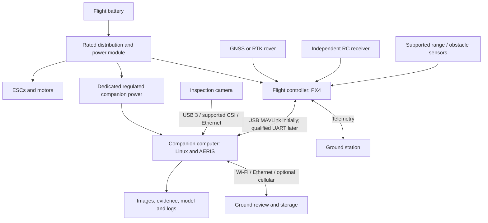

# Building an AERIS-Rail UAV: hardware, connections, OS and integration

This is a prototype design and assembly guide, not a flight-qualified bill of materials. The repository can train and run an image detector offline and simulate mission continuity. It does not yet implement a validated onboard camera/pose pipeline, live inspection-to-autopilot supervisor, physical docking or autonomous railway flight.

For a first prototype, use a supported multirotor kit with a **separate flight controller and companion computer**. Start with passive image recording on an authorized closed course, then offline inference. Do not begin by making the inspection AI responsible for flight stabilization.

## 1. Recommended architecture



The controller closes attitude/position control loops and owns vehicle failsafes. The companion captures images, runs inference, associates evidence and eventually requests mission actions. Losing the companion or cloud must not remove the controller's independent flight behavior. The aircraft/dock interface is a separate project milestone.

## 2. A practical first configuration

| Item | Suggested starting point | Why / qualification needed |
|---|---|---|
| Airframe | A documented kit explicitly rated for the measured camera, compute and power payload | Avoid designing motors, ESCs, battery and structure from independent guesses |
| Flight controller | A Pixhawk-class **Pixhawk 6C or 6X** supported by your selected PX4 release | Real-time sensor/control processing, logging and supported peripheral interfaces; check exact board/firmware target |
| Flight-controller processor | The controller's supplied STM32H7-class MCU | Runs PX4/NuttX; you do not install Ubuntu or train YOLO on this MCU |
| Onboard AI computer | **Jetson Orin Nano module with a flight-suitable carrier**, cooling and storage | CUDA inference; developer kit is useful on the bench but needs a separate mass/power/mounting assessment before flight |
| Lower-cost alternative | **Raspberry Pi 5**, suitable cooling and regulated power | Image logging and low-rate CPU inference; benchmark latency before assuming real-time operation |
| Initial camera | USB 3 machine-vision **global-shutter RGB** camera, preferably hardware-trigger capable | Short exposure and controllable optics; choose resolution from target size, not megapixels alone |
| Lens | Compatible mount, sensor coverage and adjustable/fixed focus appropriate to the planned geometry | Verify smallest asset pixels, focus, distortion and vibration sensitivity |
| Navigation | Supported multi-band GNSS; RTK if the use case needs it and corrections are available | Positioning quality is conditional; RTK does not solve occlusion, tunnels or branch identity |
| Storage | Reliable onboard SSD where supported; flight-controller logging card separately | Store original images and synchronized logs without relying on a radio link |
| Ground computer | Linux training workstation with optional NVIDIA GPU; supported ground-station software | Model training, flight setup, replay and evidence review |

This is a component family recommendation, **not** a tested compatibility claim or shopping list with guaranteed flight time. Review the [BOM worksheet](../examples/hardware/prototype_bom.csv) and fill the exact part numbers before purchasing. A camera, carrier and GNSS receiver from the same general family can still have incompatible connectors, voltage or drivers.

### Bench first, aircraft second

1. Train on your workstation and get `best.pt` using the [implementation guide](implementation_guide.md).
2. Connect the candidate camera to a workstation and inspect real-resolution images.
3. Connect the camera and model to the candidate companion on a bench.
4. Measure complete payload mass, input current, thermal behavior, capture rate, write rate and inference latency.
5. Select an airframe/propulsion kit that supports that measured load with documented operating margin.
6. Validate the vehicle independently, then introduce passive inspection recording.

A ready-to-fly research platform with documented companion integration may be cheaper overall than an unproven custom aircraft once engineering time is counted.

## 3. Selecting the CPU/computer and OS

| Location | Processor and OS | Work performed |
|---|---|---|
| Flight controller | Board-supplied MCU, PX4 firmware on NuttX | Stabilization, estimator, motor outputs, navigation modes, vehicle failsafes |
| Jetson companion | ARM64 CPU + embedded NVIDIA GPU; **JetPack image supported by the exact module/carrier** | Camera ingestion, optional CUDA inference, evidence and telemetry association |
| Pi companion | ARM64 CPU; supported 64-bit Raspberry Pi OS or Ubuntu image | Recording, telemetry and measured CPU inference |
| Training workstation | x86-64 CPU; optional supported NVIDIA GPU; supported Linux distribution | Annotation audit, training, calibration and evaluation |
| Ground station | OS supported by the selected ground-station release | Firmware setup, calibration, route review and operator monitoring |

JetPack determines the Ubuntu base, CUDA and supported PyTorch stack. Do not install arbitrary desktop Ubuntu/CUDA combinations on Jetson. Do not assume the repository's x86 CPU wheels work on ARM64. The current image pipeline was tested on CPU Python 3.12, **not on Jetson, Pi, TensorRT or an onboard flight system**.

For choosing between Jetson and Pi, benchmark the actual model, input resolution and power mode. Record median and tail inference latency, capture-to-evidence latency, dropped frames, peak/steady power and sustained temperature. Small defects may require high-resolution tiling, which can dominate latency even with a GPU.

A developer board advertised with a compute power mode is not a complete payload power budget. Carrier, camera, SSD, fans and conversion losses also consume power.

## 4. Selecting a camera and lens

### 4.1 Candidate camera categories

| Category | Useful for | Main limitations |
|---|---|---|
| USB 3 industrial global-shutter RGB | Prototype inspection with manual exposure, replaceable lens and optional hardware trigger | Many models need vendor SDKs rather than generic OpenCV/V4L2; check ARM64 support |
| CSI global-shutter module | Compact tightly integrated companion | Exact sensor/driver/carrier/OS compatibility and CSI lane/pinout matter |
| High-resolution rolling-shutter camera | Still imagery when exposure and vehicle motion permit | Motion distortion and blur must be quantified; high resolution alone does not solve either |
| Stereo/depth camera | Obstacle sensing or relative geometry experiments | Separate from diagnostic RGB; range/lighting limitations, payload and compute cost |
| Thermal camera | Specific thermal inspection questions | Does not replace visible fastener/rail imagery; needs its own data, labels and calibration |

As sensor-family examples, IMX296-based global-shutter modules are often around 1.6 MP, IMX477-based high-resolution modules around 12 MP use rolling shutter, and industrial IMX250-based global-shutter cameras around 5 MP exist. **A sensor name does not guarantee USB/CSI compatibility, image quality, hardware trigger or a usable Linux driver.** Buy a complete camera with a supported interface and documented optical/power requirements.

For the first bench study, a USB 3 global-shutter camera in roughly the 5–12 MP range is a reasonable candidate, subject to real availability, mass, shutter/driver specifications and target resolution. A lower-resolution global-shutter camera may be appropriate for navigation while being inadequate for small-defect inspection.

### 4.2 Work backward from the feature size

For an approximately nadir image over planar ground:

```text
GSD_m_per_pixel ≈ height_m × sensor_width_m / (focal_length_m × image_width_pixels)
feature_pixels ≈ feature_width_m / GSD_m_per_pixel
blur_pixels ≈ ground_speed_m_per_s × exposure_seconds / GSD_m_per_pixel
```

First specify the smallest feature that must be visible and the pixel support demonstrated by validation. Then choose lens, sensor width, image resolution and permitted acquisition geometry. These equations are optical estimates, **not flight-altitude recommendations**. Oblique views, gimbal pose, distortion, rolling shutter and terrain require a fuller model.

A fastener clearly visible in an original photo can become only a few pixels after resizing to a YOLO input. Validate detection at the actual preprocessing size. If using tiles, keep coordinate transforms and overlapping detections consistent with the original evidence image.

### 4.3 Exposure, mounting and timestamp requirements

- Use controlled exposure/gain and a focus strategy; inspect blur and saturation across expected conditions.
- Mount the camera with suitable vibration isolation and a stable known pose. A gimbal adds mass, power and a changing camera-to-body transform.
- Record original images, camera settings, intrinsics, distortion parameters and camera-to-body extrinsics.
- Prefer a documented capture timestamp or hardware trigger. USB receipt time is not necessarily exposure time.
- If a flight controller triggers a camera, use a manufacturer-supported trigger interface and establish trigger-event to image association. Do not attach an arbitrary camera input directly to a controller output.

## 5. Airframe, propulsion, battery and mechanical design

Use the airframe manufacturer's documented motor/ESC/propeller/battery combinations and payload envelope. Frame diameter alone is not a payload rating. Decide the aircraft only after measuring the complete inspection payload.

Create an all-up-mass worksheet including frame, motors, ESCs, propellers, controller, GNSS, receiver/radios, battery, regulators, computer, heatsink/fans, SSD, camera/lens, gimbal if present, cables, mounts and enclosure. Compare hover/mission loading and endurance against validated manufacturer curves, then measure them on the actual system. Do not infer safe operation from a simple static thrust sum.

Check mechanical retention, propeller clearance, center of gravity, vibration, strain relief, cooling airflow and environmental protection. Keep high-current power wiring and noisy regulators appropriately separated from GNSS/compass and sensitive signal lines. Do not assume an enclosure that protects against weather also provides adequate cooling.

Select battery chemistry, cell count, capacity, connector, charger and monitoring with the propulsion-kit documentation. Power-module voltage/current limits must cover the actual battery and load. A battery percentage displayed in a ground station is not calibrated usable return energy.

Physical charging/docking adds landing accuracy, contact geometry, electrical interlocks, battery/charger compatibility, temperature monitoring and environmental requirements. Use manual verified charging for the first prototype; no charging-dock design is supplied by AERIS.

## 6. Electrical power: separate regulated paths

```text
Battery
  ├── rated distribution → ESCs → motors
  ├── approved power module → flight-controller power input
  └── dedicated rated DC/DC → companion carrier + supported camera/storage rails
```

Check polarity, input range, continuous/peak current, thermal derating, connectors, conversion efficiency and startup surge using the actual component datasheets. Follow the selected controller/carrier grounding and isolation recommendations. Do not improvise isolated/grounded connections from this conceptual diagram.

**Do not power the Jetson or Pi from a Pixhawk telemetry connector.** Do not connect a flight battery directly to a computer GPIO or a camera. A Pi 5 needs a suitable 5 V supply and appropriate power negotiation/current capability for its peripheral load. A Jetson carrier's required DC input depends on the exact board; the module's internal rail requirements are not the carrier's external input specification.

Example budgeting equations, with measured currents and rated converters:

```text
companion_input_W ≈ (computer_W + camera_W + storage_W + peripherals_W) / converter_efficiency
companion_energy_Wh ≈ companion_input_W × mission_hours
battery_energy_Wh ≈ nominal_voltage_V × capacity_Ah
```

The final expression is nominal energy, not guaranteed usable flight energy. Propulsion, reserves, battery condition and temperature must also be accounted for. Bench-test regulator ripple, startup behavior and transient loads before integrating the flight system.

For bench wiring and software checks, remove propellers and follow the aircraft manufacturer's safe power-up procedure. Keep an independent operator control path and test the selected controller's actual loss-of-companion/RC/link behavior before any flight.

## 7. Connection matrix

| From → to | Typical interface | What to verify |
|---|---|---|
| Controller → ground setup computer | Supported USB cable / ground-station link | Board target, firmware, device enumeration and possible USB power interaction |
| Controller ↔ companion, bench | USB MAVLink | Supported port/role, stable device name, permissions, link behavior and back-powering rules |
| Controller ↔ companion, integrated | Supported TELEM UART or an approved interface | Electrical logic level, connector orientation/pinout, baud rate, MAVLink configuration and flow control |
| RGB camera → companion | USB 3, supported CSI, or Ethernet | Driver/SDK ARM64 support, bandwidth, cable retention, power and trigger/timestamp behavior |
| GNSS/RTK → controller | Board-supported GNSS UART/CAN arrangement | Exact pinout, voltage, protocol, antenna placement and correction source |
| Receiver → controller | Supported RC receiver protocol/input | Compatibility and independent operator takeover/failsafe behavior |
| Range/obstacle sensor → controller | Supported CAN/UART/I2C interface | Driver, range, update rate, latency and environmental limitations |
| Companion → storage/ground review | SSD + optional Wi-Fi/Ethernet/cellular | Buffering, authentication and behavior without connectivity |

### 7.1 UART wiring concept — not a pin-number chart

For a qualified, electrically compatible serial link:

```text
flight-controller TX  → companion UART RX
flight-controller RX  ← companion UART TX
signal ground         ↔ required reference ground, per board/interface documentation
RTS/CTS               ↔ only when supported and configured on both ends
```

Do not assume that a connector's red wire, adjacent pin or pin order identifies power or ground. Pixhawk-style connectors can look alike while serving different functions. Identify the exact flight-controller/carrier revision and use the official connector drawings.

**TTL UART is not RS-232.** Logic levels can be 3.3 V, 1.8 V or another specified level depending on board/interface. A Jetson module and a carrier's exposed serial port may differ. Use an approved level translator/interface when required. Do not join supply pins merely because TX/RX/GND connect; prevent back-powering and follow the board's grounding rules.

Start with a supported USB MAVLink link on the bench. Move to a retained UART connection only after verifying electrical requirements and reliability. Select baud rate and optional flow control from both ends' supported configuration; do not assume the same settings on every TELEM port.

### 7.2 Controller configuration

Using the supported ground station and release-specific documentation:

1. Select the exact board firmware target and airframe.
2. Complete sensor, radio, power and actuator configuration using the vendor workflow.
3. Identify the actual serial/USB port used for the companion and enable the appropriate MAVLink instance.
4. Match link settings and measure telemetry freshness/bandwidth.
5. Configure and test the applicable geofence, battery and link-loss contingencies independently of inspection inference.
6. Export the reviewed parameter file and firmware version for the experiment record.

PX4 serial/MAVLink parameter names depend on firmware and instance assignment. This guide does not provide a universal parameter file or tell you to disable pre-arm checks. The included `scripts/px4_sitl_mission.py` is specifically a local simulator demo, **not a physical-controller commissioning script**.

## 8. OS and software installation by machine

### 8.1 Training workstation

Follow [implementation guide steps 1–7](implementation_guide.md) to install the tested image stack, validate annotation, train and evaluate. The artifact you deploy is your validation-selected `best.pt`, together with:

- SHA-256, class map, inference threshold and input resolution.
- Dataset/run configuration and evaluation report.
- Framework, torch/torchvision and preprocessing versions.
- Any cropping/tiling/calibration rules and their versions.

Do not send only `best.pt` and lose the meaning of class IDs and preprocessing.

### 8.2 Jetson companion

1. Flash the **module/carrier-supported JetPack** using NVIDIA/carrier instructions.
2. Verify cooling, power mode, camera driver, storage and network before installing AERIS.
3. Install NVIDIA-supported PyTorch/torchvision versions for that JetPack/Python combination. Record the exact wheel/container origin and version.
4. Use a compatible environment; if the validated torch installation is in system Python, a `--system-site-packages` venv can reuse it. Confirm that this matches the vendor-supported installation method.
5. Review dependency resolution before installing the optional vision stack. Do not let an x86-oriented recipe replace working Jetson CUDA packages.

Useful inspection commands after entering your chosen environment:

```sh
python -c "import platform; print(platform.machine()); print(platform.python_version())"
python -c "import torch; print(torch.__version__); print(torch.cuda.is_available())"
python -m pip install --dry-run -r requirements-vision.txt
```

The dry run is for inspection, not an installation guarantee. If it proposes replacing supported torch/torchvision with incompatible builds, stop and create a platform-specific requirements set based on the vendor matrix. `requirements-vision.txt` is the tested **desktop CPU baseline**, not a certified JetPack installation lockfile.

A Jetson-compatible container is an alternative when maintained for the exact JetPack/L4T release. Camera/GPU device access, host driver compatibility, storage and power behavior still need validation. No container image is built or certified in this repository.

### 8.3 Raspberry Pi companion

Install a supported 64-bit OS with the exact camera driver and adequate cooling. Set up an ARM64-compatible Python/torch/vision stack, confirm the camera, then run the same still-image inference command on recorded images. Start with `--device cpu`. Hardware accelerators introduce new model formats, runtimes and calibration/testing requirements; they are not automatically supported by the current wrapper.

### 8.4 Controller and ground station

Flash PX4 using the board/release-specific supported workflow. Install a ground station supported by that firmware, commonly QGroundControl for PX4. Keep aircraft configuration separate from the AI Python environment. Archive firmware hashes and reviewed parameter exports rather than relying on a workstation's current GUI state.

## 9. Connecting the camera to AERIS

The current input is **local still-image files**. A USB camera being visible in Linux does not automatically connect it to `aeris.vision`.

For a Linux V4L2-compatible camera, these external OS tools can help inspect enumeration/capabilities after installation of the distribution's `v4l-utils` package:

```sh
v4l2-ctl --list-devices
v4l2-ctl --device /dev/video0 --list-formats-ext
```

`/dev/video0` is an example, not a stable camera identity. Vendor-SDK cameras may not expose this interface. CSI cameras on Pi/Jetson can require platform-specific pipelines rather than generic OpenCV capture.

Use the supported camera application/SDK to save original-resolution sample images to a known folder. Set and record exposure, gain, resolution, pixel format and capture timestamp. Do not use an arbitrary compressed preview as diagnostic evidence.

After transferring your validated weights and test captures, run the existing AERIS command on the companion:

```sh
python -m aeris.vision predict --weights /absolute/path/to/best.pt --source /absolute/path/to/captures --conf 0.25 --imgsz 1024 --device cpu --output outputs/companion-inference-001
```

On a validated CUDA-enabled Jetson stack, benchmark a separate run with `--device 0`. Replace `0.25` and `1024` with the validation-selected threshold and preprocessing size for your model. Those example values are not operational settings.

Compare the same images/weights on workstation and companion: class mapping, boxes, scores, missing detections and latency. If you export to ONNX/TensorRT later, repeat this parity test; numerical or preprocessing changes may require recalibration. The current wrapper loads `.pt`, not a certified TensorRT deployment.

## 10. Live integration work still required

Build the live system as independently testable components:

```text
camera/SDK → timestamped image record ─┐
                                     ├→ image/pose association → inference → evidence journal
MAVLink telemetry → pose and health ──┘                                      ↓
                                                    accepted coverage + review candidates
                                                                            ↓
                                             asynchronous mission supervisor → autopilot
```

### 10.1 Camera service

Implement a capture adapter for your exact camera. It must report original image ID/hash, exposure timestamp and clock domain, intrinsics, extrinsics/gimbal pose, exposure/gain and dropped-frame status. Handle disconnects and storage-full errors explicitly. Store raw data before advancing coverage.

### 10.2 Telemetry and pose association

Implement a physical-link adapter separate from the local SITL scripts. Read pose, pose uncertainty, autopilot state, battery and time synchronization with stable device naming and freshness checks. Validate image/pose interpolation, clock offsets, camera optical coordinates, ENU/NED and height references against independent truth. GNSS antenna location is not camera pose without the calibrated transform.

### 10.3 Inference and evidence

Reuse the image wrapper's model/preprocessing and output schema, but load weights once per worker. Add frame quality, asset observability, complete detections, model hash and pose uncertainty to immutable evidence records. Measure end-to-end latency and buffering. An empty detector result must not imply successful healthy coverage.

### 10.4 Mission requests

The synchronous abstract `Simulator` is not a real-time controller. Add an asynchronous supervisor with command IDs, acknowledgements, timeout/cancellation, completion evidence and contingency states. Inspection may request a bounded recapture or route action only within separately validated limits. Low confidence, stale telemetry or missing imagery should leave unresolved evidence, not silently mark completion.

### 10.5 Companion services

Only after the adapters are tested should you package camera, telemetry, inference and journal services for restart/logging (for example with systemd). Define boot order, storage readiness, model validation and behavior on process restart. There is no production service unit or auto-flight startup command in this repository; inventing one would mask these missing prerequisites.

**Bench milestone:** camera recording + telemetry recording + offline image/pose association, with no flight commands from the companion. **Next milestone:** the same pipeline driven by simulator truth and tested contingencies. Physical mission requests follow only after that integration is independently evaluated.

## 11. GNSS, range sensing and obstacle handling

For RTK, specify the rover, antenna, correction source/base or NTRIP connection, correction transport, coordinate reference and quality flags. A device advertised as RTK capable does not guarantee fixed solutions. Record degraded/floating/no-fix behavior and verify the application's response.

A depth/range sensor can help with height or obstacle experiments, but its outdoor range, glare/weather sensitivity, mounting, driver support and blind spots must be tested. Railway catenary, wires, moving trains and narrow structures are not made safe by a general RGB defect detector. Railway/aviation constraints and independent vehicle sensing remain separate operational requirements.

## 12. Assembly and acceptance sequence

| Stage | Action | Evidence before advancing |
|---|---|---|
| A | Complete exact BOM and power/weight/interface worksheets | Supported combinations, verified connector/power drawings, measured or rated loads |
| B | Bench computer + camera without propulsion | Original images, sustained recording, thermal/power measurements |
| C | Offline model on companion | Workstation parity, measured latency/drop rate and saved evidence |
| D | Controller configuration and telemetry, propellers removed | Correct firmware, calibrated sensors, exported parameters, stable link |
| E | Camera/telemetry synchronization without companion flight commands | Known timestamps, transform checks, missing-data behavior |
| F | Vehicle-only SITL and inspection replay | Verified route/return/contingency results; see the implementation guide |
| G | Authorized operator-controlled closed-course collection | Independent inspection labels and flight telemetry |
| H | Reviewed integrated mission tests | Documented acceptance criteria and failure/contingency results |
| I | Dock development and repeated sortie automation | Landing/charging verification, failure handling and durable coverage recovery |

The sequence is not a claim that the later stages are approved or ready. Railway access, aviation authorization, qualified operation and location-specific constraints must be established for real tests. Do not use an active railway as the first integration site.

## 13. What to buy/build first

For the lowest-risk engineering order:

1. A camera/lens combination and access to representative licensed railway imagery.
2. A workstation environment to train/evaluate and produce `best.pt`.
3. A companion development setup with regulated bench power, cooling and storage.
4. A supported controller/airframe kit selected around the measured payload.
5. Navigation/telemetry/independent operator-control components required by that kit.
6. Only after integration evidence: specialized depth sensors, RTK upgrades, custom carrier and dock.

The key project-specific decisions still needed are **smallest target feature, actual camera-to-track geometry, payload/endurance requirement, operating location, available budget and existing aircraft hardware**. The suggested families above let you start bench work without pretending those missing inputs have been resolved.

## 14. Manufacturer and integration references

These are official starting points, not an independently verified current compatibility matrix. Use the exact board/carrier/firmware revision documentation and confirm availability/support before purchasing.

- PX4 flight-controller hardware: https://docs.px4.io/main/en/flight_controller/
- PX4 companion computers: https://docs.px4.io/main/en/companion_computer/
- PX4 serial configuration: https://docs.px4.io/main/en/peripherals/serial_configuration.html
- Holybro hardware documentation, including exact Pixhawk connector drawings: https://docs.holybro.com/
- NVIDIA Jetson and JetPack: https://developer.nvidia.com/embedded/jetson and https://developer.nvidia.com/embedded/jetpack
- NVIDIA Jetson Linux documentation: https://docs.nvidia.com/jetson/
- Raspberry Pi hardware, power and camera documentation: https://www.raspberrypi.com/documentation/
- QGroundControl documentation: https://docs.qgroundcontrol.com/
- MAVSDK Python documentation and API/version migration: https://mavsdk.mavlink.io/main/en/python/
- OpenCV camera calibration concepts: https://docs.opencv.org/4.x/dc/dbb/tutorial_py_calibration.html

No hardware was purchased, wired, powered or flown as part of adding this guide. The only already-exercised AERIS hardware-adjacent behavior is offline image processing and abstract simulation, as recorded in the implementation guide.
